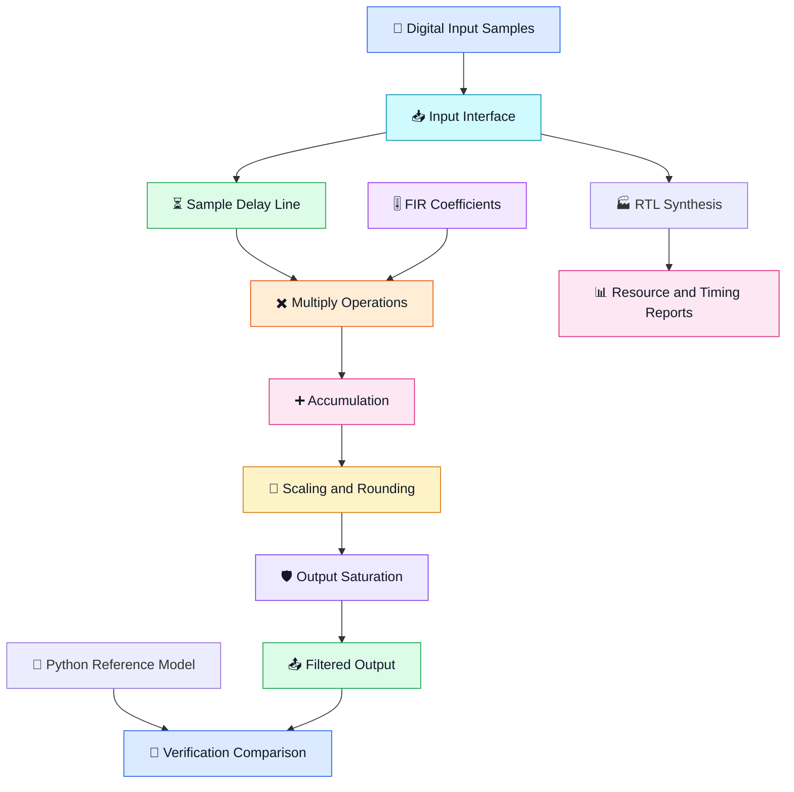
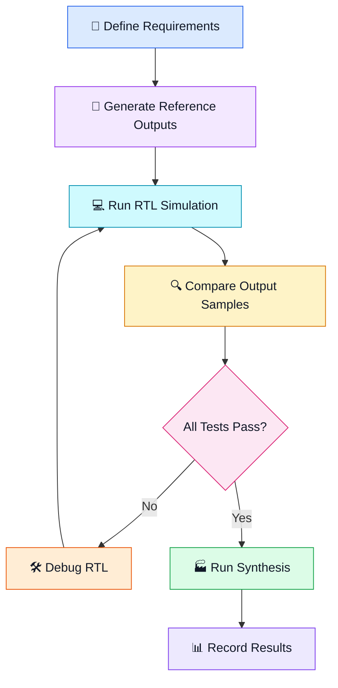

<div align="center">

# ⚡ HARDWARE-ACCELERATED FIR FILTER ⚡

### 🎛️ Digital Signal Processing Meets Hardware Design

**A Configurable Low-Pass FIR Filter Using Verilog, Python & Open-Source EDA Tools**

<br>

<a href="https://www.verilog.com/">

</a>
<a href="https://www.python.org/">

</a>
<a href="https://verilator.org/">

</a>
<a href="https://yosyshq.readthedocs.io/">

</a>

<br><br>


<br>

### 🚀 DESIGN • SIMULATE • VERIFY • SYNTHESIZE • OPTIMIZE

</div>

---

<div align="center">

## 🌌 PROJECT OVERVIEW

</div>

**Hardware-Accelerated FIR Filter** is a digital hardware design
project focused on implementing a configurable Finite Impulse
Response (FIR) low-pass filter using Verilog/SystemVerilog.

The project combines digital signal processing, fixed-point
arithmetic, RTL development, Python-based reference modeling,
functional verification, and synthesis-based hardware analysis.

The goal is to build a reliable hardware implementation, verify
its numerical behavior, and investigate architectures that improve
throughput, latency, and hardware efficiency.

### 💎 Project Highlights

| Feature | Description |
|:---|:---|
| 🔵 RTL Design | Implement the FIR filter in synthesizable Verilog |
| 🟡 DSP Algorithm | Develop a low-pass finite impulse response filter |
| 🟢 Fixed-Point Math | Implement signed integer arithmetic |
| 🟣 Python Reference | Generate coefficients and calculate expected outputs |
| 🟠 Functional Verification | Compare RTL outputs with the reference model |
| 🔴 Logic Synthesis | Analyze hardware structure using Yosys |
| ⚡ Performance Analysis | Measure latency, throughput, and resource usage |
| 🚀 Architecture Optimization | Explore pipelining, symmetry, and resource sharing |

> 🎯 **Engineering objective:** Develop a reproducible workflow that
> connects a mathematical DSP algorithm to verified RTL and measurable
> hardware implementation results.

---

# 🧭 TABLE OF CONTENTS

- [01. Introduction](#-01-introduction)
- [02. What Is an FIR Filter?](#-02-what-is-an-fir-filter)
- [03. Mathematical Foundation](#-03-mathematical-foundation)
- [04. System Architecture](#-04-system-architecture)
- [05. Technology Stack](#-05-technology-stack)
- [06. Design Specifications](#-06-design-specifications)
- [07. Fixed-Point Arithmetic](#-07-fixed-point-arithmetic)
- [08. Repository Structure](#-08-repository-structure)
- [09. Getting Started](#-09-getting-started)
- [10. Python Reference Model](#-10-python-reference-model)
- [11. RTL Verification](#-11-rtl-verification)
- [12. Simulation and Synthesis](#-12-simulation-and-synthesis)
- [13. Performance Evaluation](#-13-performance-evaluation)
- [14. Architecture Optimization](#-14-architecture-optimization)
- [15. Testing Strategy](#-15-testing-strategy)
- [16. Development Roadmap](#-16-development-roadmap)
- [17. Applications](#-17-applications)
- [18. Engineering Skills](#-18-engineering-skills)
- [19. Limitations and Future Work](#-19-limitations-and-future-work)
- [20. References](#-20-references)

---

# 🔷 01. INTRODUCTION

Digital filters are fundamental components of digital signal
processing systems. They are used to remove unwanted frequency
components, suppress noise, and shape signals.

A software implementation is useful for algorithm development,
but a hardware implementation can process samples through dedicated
digital logic.

This project investigates how a configurable FIR algorithm can be
implemented in RTL and evaluated using open-source tools.

### 🌟 Why This Project?

Traditional DSP development separates algorithm design from
hardware implementation.

This project brings the two together through a workflow that
supports numerical verification and hardware analysis.

**The project aims to answer four important questions:**

1. 🧮 Does the RTL produce the expected fixed-point output?
2. ⚡ How many clock cycles are required to produce a result?
3. 🏭 What hardware resources does synthesis infer?
4. 🚀 Which architecture offers the best trade-off between
   throughput, latency, and resource usage?

---

# 🎛️ 02. WHAT IS AN FIR FILTER?

FIR stands for **Finite Impulse Response**.

An FIR filter computes an output by multiplying the current and
previous input samples by filter coefficients and adding the products.

Unlike an infinite impulse response filter, the standard FIR
structure does not require feedback from previous output samples.

### 🧠 Basic Concept

```text
Input Samples
     |
     v
+-------------------+
| Sample Delay Line |
+-------------------+
     |
     v
+-------------------+
| Coefficient       |
| Multiplication    |
+-------------------+
     |
     v
+-------------------+
| Summation         |
+-------------------+
     |
     v
+-------------------+
| Fixed-Point       |
| Output Processing |
+-------------------+
     |
     v
Filtered Output
```

### ✨ Key Characteristics

| Characteristic | Explanation |
|:---|:---|
| Finite response | A finite-length input impulse response |
| No recursive feedback | The standard FIR equation uses input samples |
| Configurable response | Coefficients determine the filter characteristics |
| Linear phase | Possible when coefficients have the required symmetry |
| Fixed-point implementation | Supports efficient integer-based digital hardware |
| Parallel implementation | Multiple products can be calculated concurrently |

---

# 📐 03. MATHEMATICAL FOUNDATION

The fundamental FIR equation is:

\[
y[n] = \sum_{k=0}^{N-1} h[k]x[n-k]
\]

Where:

| Symbol | Meaning |
|:---:|:---|
| \(y[n]\) | Current output sample |
| \(x[n]\) | Current input sample |
| \(x[n-k]\) | Delayed input sample |
| \(h[k]\) | Filter coefficient |
| \(N\) | Number of filter taps |
| \(n\) | Discrete-time sample index |

For a 16-tap FIR filter:

\[
y[n] = h[0]x[n] + h[1]x[n-1] + \cdots
       + h[15]x[n-15]
\]

### 🔍 What Happens During Processing?

1. A new input sample arrives.
2. Previous samples are retained in the delay line.
3. Samples are multiplied by their corresponding coefficients.
4. The products are added together.
5. The accumulated result is scaled to the output format.
6. The filtered output is produced according to the RTL interface.

The actual number of clock cycles depends on the implemented
architecture and its pipeline structure.

---

# 🏗️ 04. SYSTEM ARCHITECTURE

The proposed architecture separates the input interface, sample
storage, arithmetic, and output processing.



### 🧩 Architecture Components

| Component | Function |
|:---|:---|
| Input interface | Receives digital samples |
| Delay line | Stores previous samples |
| Coefficient storage | Provides quantized filter coefficients |
| Multiplication stage | Multiplies samples by coefficients |
| Accumulator | Adds the multiplication results |
| Scaling stage | Adjusts the fixed-point representation |
| Saturation logic | Clamps values to the permitted output range |
| Output interface | Delivers the filtered sample |

*The diagram is conceptual. The final implementation must match the
actual RTL, including its pipeline and valid-signal behavior.*

---

# 🛠️ 05. TECHNOLOGY STACK

<div align="center">

| Technology | Purpose |
|:---|:---|
| 🔵 Verilog/SystemVerilog | RTL hardware description |
| 🟢 Verilator | RTL linting and simulation |
| 🟡 Python | Reference model and test automation |
| 🟣 NumPy | Numerical operations |
| 🟠 SciPy | FIR coefficient generation |
| 🔷 Yosys | Logic synthesis and statistics |
| ⚫ Git | Version control |
| 🐙 GitHub | Repository hosting and collaboration |

</div>

### 💻 Development Environment

The project can be developed on Windows, Linux, or Ubuntu through
WSL, provided the required tools are installed.

The core workflow uses open-source tools.

Specific FPGA implementation, physical-design, or power-analysis
flows may require additional tools and technology files.

---

# ⚙️ 06. DESIGN SPECIFICATIONS

The following table describes the proposed baseline configuration.

| Parameter | Target |
|:---|:---|
| Filter type | Low-pass FIR |
| Number of taps | 16 |
| Input data width | 16 bits |
| Coefficient width | 16 bits |
| Arithmetic | Signed fixed-point |
| Coefficient format | Q1.15 |
| Accumulator width | 40 bits |
| Reset | Synchronous, active-high |
| Input valid signal | `in_valid` |
| Output valid signal | `out_valid` |
| Reference model | Python |
| RTL analysis | Verilator and Yosys |

> ⚠️ These are baseline design targets. Confirm each specification
> against the implemented RTL and testbench before describing it
> as a verified feature.

### 📌 Interface Concept

| Signal | Purpose |
|:---|:---|
| `clk` | Clock input |
| `rst` | Reset control |
| `in_valid` | Indicates an accepted input sample |
| `in_data` | Signed input sample |
| `out_valid` | Indicates a valid output sample |
| `out_data` | Signed filtered output |

The final RTL must define the exact handshake, reset timing, and
behavior when valid signals are deasserted.

---

# 🔢 07. FIXED-POINT ARITHMETIC

Fixed-point arithmetic represents fractional numbers using scaled
integers.

For a signed Q1.15 coefficient:

\[
h_{\mathrm{real}} = \frac{h_{\mathrm{integer}}}{2^{15}}
\]

The quantization operation is:

\[
h_q[k] = \operatorname{round}(h[k]\times 2^{15})
\]

### 🧮 Arithmetic Flow

```text
Signed Input Sample
       |
       v
Signed Coefficient
       |
       v
32-Bit Product
       |
       v
Wide Accumulator
       |
       v
Fixed-Point Scaling
       |
       v
Rounding (if implemented)
       |
       v
Saturation (if implemented)
       |
       v
16-Bit Output
```

### 🛡️ Numerical Considerations

- Signed multiplication must preserve the correct operand widths.
- Product widths must accommodate the complete multiplication result.
- Accumulator sizing must account for the sum of all products.
- Truncation and rounding must be documented.
- Output overflow behavior must be defined.
- Coefficient quantization must be consistent with the RTL.

For bit-exact verification, the Python reference model must reproduce
the same integer arithmetic, scaling, rounding, and saturation rules.

---

# 📁 08. REPOSITORY STRUCTURE

```text
hardware-accelerated-fir-filter/
│
├── rtl/
│   └── fir_filter.sv
│
├── python/
│   ├── reference.py
│   └── generate_coefficients.py
│
├── tests/
│   ├── test_fir.py
│   └── testbench.sv
│
├── scripts/
│   └── run_all.sh
│
├── results/
│   ├── verification.txt
│   └── synthesis.txt
│
├── requirements.txt
├── README.md
├── LICENSE
└── .gitignore
```

### 📂 Directory Responsibilities

| Directory | Responsibility |
|:---|:---|
| `rtl/` | Synthesizable hardware design |
| `python/` | Numerical reference and coefficient tools |
| `tests/` | Verification code and testbenches |
| `scripts/` | Repeatable development commands |
| `results/` | Actual verification and synthesis reports |

Only include files that exist and are relevant to your implementation.

---

# 🚀 09. GETTING STARTED

## Step 1 — Clone the Repository

```bash
git clone https://github.com/YOUR_USERNAME/hardware-accelerated-fir-filter.git
cd hardware-accelerated-fir-filter
```

Replace `YOUR_USERNAME` with your GitHub username.

## Step 2 — Install Python Dependencies

```bash
python -m venv .venv
```

Activate the environment on Linux or Ubuntu WSL:

```bash
source .venv/bin/activate
```

Install the Python packages:

```bash
python -m pip install numpy scipy
```

## Step 3 — Check the Tools

```bash
python --version
verilator --version
yosys -V
```

If a command is unavailable, install the corresponding tool before
running that part of the workflow.

---

# 🐍 10. PYTHON REFERENCE MODEL

Python provides an independent numerical model against which the
RTL implementation can be verified.

### 🎚️ Example Coefficient Generation

Save the following as `python/generate_coefficients.py`:

```python
import json
from pathlib import Path

import numpy as np
from scipy.signal import firwin

TAPS = 16
CUTOFF = 0.2
FRACTIONAL_BITS = 15


def generate_coefficients():
    """Generate quantized low-pass FIR coefficients."""

    floating_coefficients = firwin(
        numtaps=TAPS,
        cutoff=CUTOFF,
        window="hamming",
        pass_zero="lowpass"
    )

    scale = 1 << FRACTIONAL_BITS

    integer_coefficients = np.rint(
        floating_coefficients * scale
    ).astype(np.int64)

    if np.any(integer_coefficients < -32768):
        raise ValueError("Coefficient below signed 16-bit range")

    if np.any(integer_coefficients > 32767):
        raise ValueError("Coefficient above signed 16-bit range")

    return floating_coefficients, integer_coefficients


def main():
    floating, integer = generate_coefficients()

    output = {
        "taps": TAPS,
        "cutoff_normalized_to_nyquist": CUTOFF,
        "fractional_bits": FRACTIONAL_BITS,
        "coefficients": integer.tolist()
    }

    output_path = Path("coefficients.json")
    output_path.write_text(
        json.dumps(output, indent=2),
        encoding="utf-8"
    )

    print("Floating-point coefficients:")
    print(floating)

    print("\nQuantized coefficients:")
    print(integer.tolist())

    print(f"\nSaved coefficients to {output_path}")


if __name__ == "__main__":
    main()
```

Run from the repository root:

```bash
python python/generate_coefficients.py
```

This script generates quantized coefficients. The RTL must use the
same coefficient values and ordering for a valid comparison.

### 🧪 Reference Model Requirements

A complete reference model should:

1. Accept the same input samples as the RTL.
2. Use the exact quantized coefficient integers.
3. Reproduce the intended accumulator behavior.
4. Apply the same output scaling.
5. Match rounding and saturation behavior.
6. Account for reset and valid-signal timing.

A floating-point convolution is useful for checking the ideal filter
response, but it is not automatically bit-exact with fixed-point RTL.

---

# 🧪 11. RTL VERIFICATION

Verification is essential for demonstrating that the RTL correctly
implements the mathematical filter.

### 🟢 Recommended Test Cases

| Test | Input | Purpose |
|:---|:---|:---|
| TC01 | All zeros | Check zero-input response |
| TC02 | Impulse | Check coefficient ordering |
| TC03 | Constant positive values | Check steady-state behavior |
| TC04 | Constant negative values | Check signed arithmetic |
| TC05 | Alternating positive and negative values | Exercise arithmetic |
| TC06 | Random samples | Broad functional coverage |
| TC07 | Minimum and maximum inputs | Check boundary behavior |
| TC08 | Reset during operation | Verify reset semantics |
| TC09 | Gaps in valid signals | Verify handshake behavior |
| TC10 | Back-to-back samples | Evaluate sustained throughput |

### 📊 Numerical Error

For each matched output sample:

\[
e[n] = y_{\mathrm{RTL}}[n] - y_{\mathrm{reference}}[n]
\]

Maximum absolute error:

\[
E_{\max} = \max_n |e[n]|
\]

Root mean square error:

\[
E_{\mathrm{RMS}} =
\sqrt{\frac{1}{M}\sum_{n=0}^{M-1} e[n]^2}
\]

For a bit-exact integer reference model, the target is:

\[
E_{\max}=0
\]

The comparison must match corresponding samples after accounting
for pipeline latency and valid-signal behavior.

### ✅ Verification Completion Criteria

- [ ] RTL compiles successfully.
- [ ] Testbench executes successfully.
- [ ] Signed input values are handled correctly.
- [ ] Reset behavior is verified.
- [ ] All output-valid events are accounted for.
- [ ] RTL and Python use identical coefficients.
- [ ] Arithmetic behavior matches the reference model.
- [ ] Regression tests pass.

---

# 🏭 12. SIMULATION AND SYNTHESIS

## 🔬 Verilator

Verilator can be used to lint the RTL and identify potential issues.

Example lint command:

```bash
verilator --lint-only -Wall rtl/fir_filter.sv
```

This is an initial lint example. Additional source files, timing
options, or top-module settings may be required by your design.

## 🔷 Yosys

Yosys can synthesize supported RTL and report the resulting logic
structure.

Example:

```bash
yosys -p "read_verilog -sv rtl/fir_filter.sv; hierarchy -top fir_filter; proc; opt; stat"
```

Replace `fir_filter` if your top-level module uses a different name.

### ⚠️ Important

A successful synthesis command does not prove functional correctness,
timing closure, or physical power consumption.

Use separate verification and implementation flows to establish
those properties.

---

# 📈 13. PERFORMANCE EVALUATION

The project will evaluate the relationship between the FIR
architecture and its performance.

### ⚡ Metrics

| Metric | Definition |
|:---|:---|
| Latency | Cycles from accepted input to corresponding output |
| Initiation interval | Cycles between successive accepted inputs |
| Throughput | Sustained number of processed samples per second |
| Critical-path delay | Delay along the slowest constrained timing path |
| Logic usage | Synthesized combinational resources |
| Register usage | Synthesized sequential resources |
| Multiplier count | Number of inferred multiplication resources |
| Power estimate | Estimate obtained using a suitable implementation flow |

### 🧮 Throughput Formula

For an architecture accepting one sample every \(II\) clock cycles:

\[
R = \frac{f_{\mathrm{clock}}}{II}
\]

where:

- \(R\) is the sample throughput.
- \(f_{\mathrm{clock}}\) is the operating clock frequency.
- \(II\) is the initiation interval.

### 📊 Results Dashboard

| Measurement | Baseline | Optimized |
|:---|:---:|:---:|
| Functional verification | Pending | Pending |
| Latency | Pending | Pending |
| Initiation interval | Pending | Pending |
| Throughput | Pending | Pending |
| Logic resources | Pending | Pending |
| Register count | Pending | Pending |
| Critical-path delay | Pending | Pending |
| Power estimate | Pending | Pending |

**Results policy:** Populate this table only after running the
appropriate tools. Record the tool versions, constraints, target
technology, and measurement method.

---

# 🧠 14. ARCHITECTURE OPTIMIZATION

Optimization begins only after the baseline implementation has been verified 

## 🔵 A. Pipelined FIR

Pipeline registers divide long combinational paths into shorter
stages.

Potential benefits:

- Improved timing performance.
- Higher achievable clock frequency.
- Better scalability for larger filters.

Trade-offs:

- Additional registers.
- Increased latency.
- More complex control-signal alignment.

## 🟣 B. Symmetric FIR

For symmetric coefficients:

\[
h[k]=h[N-1-k]
\]

the output can be rewritten for an even number of taps as:

\[
y[n] =
\sum_{k=0}^{N/2-1}
h[k]\left(x[n-k]+x[n-(N-1-k)]\right)
\]

This can reduce the number of multiplications.

However, it requires symmetric coefficients and introduces
pre-addition logic that may affect the critical path.

## 🟢 C. Resource-Shared FIR

A resource-shared architecture reuses arithmetic hardware across
multiple cycles.

Potential benefits:

- Reduced multiplier count.
- Lower hardware-area requirements.

Trade-offs:

- More cycles per output in many implementations.
- Additional control logic.
- Potentially lower throughput.

### 🧪 Optimization Comparison

Every architecture should use equivalent functional requirements
and identical verification vectors.

Compare:

1. Numerical correctness.
2. Latency.
3. Initiation interval.
4. Synthesized resources.
5. Critical-path delay.
6. Power estimates, when available.

---

# 🧪 15. TESTING STRATEGY

A reproducible testing strategy should separate functional
verification from performance evaluation.

### Verification Workflow



### 📋 Reproducibility Checklist

- [ ] Document tool versions.
- [ ] Fix the test vectors and random seeds.
- [ ] Record coefficient values.
- [ ] Save simulation logs.
- [ ] Save synthesis reports.
- [ ] Record timing constraints.
- [ ] Document any failed tests.
- [ ] Keep measured results separate from estimates.

---

# 🗺️ 16. DEVELOPMENT ROADMAP

### 🟢 PHASE 1 — BASELINE DESIGN

- [ ] Complete the synthesizable FIR RTL.
- [ ] Generate quantized coefficients.
- [ ] Build an integer Python reference model.
- [ ] Develop a self-checking testbench.
- [ ] Verify reset and handshake behavior.

### 🔵 PHASE 2 — FUNCTIONAL VERIFICATION

- [ ] Verify impulse response.
- [ ] Test signed arithmetic.
- [ ] Exercise boundary conditions.
- [ ] Compare RTL and reference outputs.
- [ ] Automate regression testing.

### 🟣 PHASE 3 — SYNTHESIS AND ANALYSIS

- [ ] Run Yosys synthesis.
- [ ] Record resource statistics.
- [ ] Measure latency and initiation interval.
- [ ] Add timing constraints where appropriate.
- [ ] Establish a reproducible baseline.

### 🟠 PHASE 4 — OPTIMIZATION

- [ ] Explore pipelining.
- [ ] Investigate symmetric coefficients.
- [ ] Compare resource-shared architectures.
- [ ] Evaluate hardware resource trade-offs.
- [ ] Publish verified comparisons.

### 🔴 PHASE 5 — ADVANCED DEVELOPMENT

- [ ] Add configurable coefficient support.
- [ ] Integrate automated regression workflows.
- [ ] Explore FPGA implementation.
- [ ] Investigate formal verification.
- [ ] Evaluate suitable power-estimation flows.

---

# 🌍 17. APPLICATIONS

FIR filters are used in a broad range of digital signal-processing
systems.

| Application | Example |
|:---|:---|
| 📡 Wireless communication | Channel filtering and signal conditioning |
| 🎵 Audio processing | Noise reduction and frequency shaping |
| 📻 Software-defined radio | Digital front-end filtering |
| 📈 Sensor systems | Smoothing sampled measurements |
| 🛰️ Radar and instrumentation | Signal conditioning |
| 🎛️ Embedded DSP | Filtering digitized input data |

This project provides a learning platform for understanding
how FIR algorithms translate into digital hardware.

It is not, by itself, a validated implementation for safety-critical
or production systems.

---

# 🎓 18. ENGINEERING SKILLS

Working through this project develops practical skills in:

- RTL coding and hardware architecture.
- Digital signal processing.
- Signed fixed-point arithmetic.
- Verilog/SystemVerilog simulation.
- Python reference modeling.
- Automated functional verification.
- Logic synthesis and resource analysis.
- Timing and throughput evaluation.
- Git and GitHub project management.
- Technical documentation.

### 💼 Relevant Engineering Domains

`FPGA Design` · `RTL Design` · `Digital Design Verification` ·
`DSP Hardware` · `VLSI Design` · `Hardware Optimization`

---

# 🔮 19. LIMITATIONS AND FUTURE WORK

### Current Limitations

The project's maturity depends on the implementation and test
results actually committed to the repository.

Potential areas requiring additional work include:

- Bit-exact arithmetic verification.
- Complete automated testbench coverage.
- Target-specific synthesis.
- Timing analysis with appropriate constraints.
- Hardware power estimation.
- Comparison of alternative architectures.

### Future Enhancements

- Runtime-programmable coefficients.
- Higher-throughput pipelined FIR implementations.
- Symmetric-filter optimization.
- Automated synthesis-report collection.
- FPGA resource and timing evaluation.
- Continuous integration.
- Formal verification of interface properties.

---

# 📚 20. REFERENCES

- [Verilator Documentation](https://verilator.org/guide/latest/)
- [Yosys Documentation](https://yosyshq.readthedocs.io/)
- [NumPy Documentation](https://numpy.org/doc/)
- [SciPy Signal Processing Documentation](https://docs.scipy.org/doc/scipy/reference/signal.html)
- [Python Documentation](https://docs.python.org/3/)
- [IEEE Xplore Digital Library](https://ieeexplore.ieee.org/)

---

<div align="center">

# 💜 BUILDING BETTER DIGITAL HARDWARE 💜

### From Mathematical Models to Verified RTL

<br>


<br>

**DESIGN SMART. VERIFY DEEPLY. OPTIMIZE MEASURABLY.**

</div>